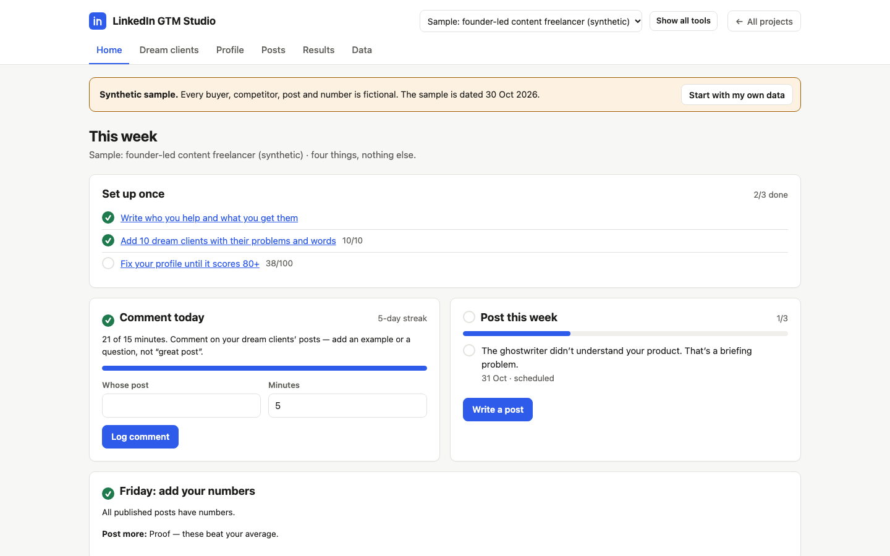

# LinkedIn GTM Studio

A working studio for winning clients on LinkedIn, built around a six-step playbook: research buyers and competitors →
optimise the profile → plan four content buckets → match each post with the right visual → comment for 15 minutes a
day → measure, double down and cut. It comes with a Claude skill that drafts profiles and posts from the research and
checks them against the same rules.

Built for freelancers who run LinkedIn for themselves **and** for clients: each personal brand gets its own workspace.

**Live demo:** https://dash-boop0.github.io/linkedin-gtm-studio/ (opens with a clearly labelled synthetic sample)



## Simple view (default)

Opens on a **This week** screen with just four things: set up once (offer, 10 dream clients, profile 80+),
comment today (log it right there), post this week, and add Friday numbers. The tabs are cut down to
Home · Dream clients · Profile · Posts · Results · Data. **Show all tools** in the header brings back everything below;
the choice is remembered in the browser.

## Features

| Step | In the app |
|---|---|
| 1 · Research | Dream-buyer list (target 10) with their struggles, what they tried and their exact words → a **language bank** counting how many buyers said each thing. Competitor post log (target 5 competitors) broken down by topic, angle, hook type and graphic, ranked by median weighted engagement. Ideas saved from X / newsletters with your own take. |
| 2 · Profile | Offer builder, headline suggestion, and a **16-check live audit** of headline, banner, About and Featured, including whether you use your buyers' words. |
| 3 · Buckets | Buyer problems / Industry take / Expertise / Case studies & work stories, with target mix, a 4-week calendar and **idea prompts generated from your research**. |
| 4 · Visuals | Every post records what it shows; the studio recommends the visual (result → highlighted screenshot, process → steps graphic, comparison → side by side, walkthrough → carousel, personal → photo). |
| Post checks | Hook length, preview break, paragraph density, hashtags, links, buyer language, closing prompt — live while you write. |
| 5 · Engage | Daily comment log (ideal customer vs their network), streak, 14-day chart. |
| 6 · Analytics | Engagement rate and leads per 1,000 impressions by bucket, hook type, visual and post type, with **double down / cut / keep testing / need more posts** verdicts. |
| Data | Workspaces per client, CSV import (buyers, competitor posts, your post metrics) with templates, JSON backup/restore, settings. |

## Quick start

No install, no build, no API keys.

```bash
git clone https://github.com/Dash-boop0/linkedin-gtm-studio.git
cd linkedin-gtm-studio
python3 -m http.server 8000      # Windows: py -m http.server 8000   (or: npx serve)
```

Open http://localhost:8000. It must be served over http (not opened as a file) so the sample data can load.

## Using it for a client

1. **Data → New workspace** — “Client: <name>”. Switch workspaces from the header.
2. **Research** — add their 10 dream buyers while reading those buyers’ posts and comments; paste the exact phrases.
   Log 3–5 top posts from each of 5 competitors (numbers from the post itself).
3. **Profile** — fill in the offer, rewrite until the audit is green.
4. **Content** — use idea prompts, keep the bucket mix near target, follow the visual recommendation.
5. **Engage** — log the daily 15 minutes.
6. **Analytics** — after posts go out, copy the numbers from LinkedIn’s post analytics (or import a CSV).
   Review weekly. Export the posts CSV for a client report.

## The Claude skill (`skill/linkedin-gtm/`)

`SKILL.md` teaches Claude (Claude Code or a Claude.ai project) to read a studio backup, draft a profile rewrite,
a weekly plan or posts in the buyers’ own words, and check every draft with the studio’s rules:

```bash
node scripts/cli.mjs summary backup.json "Client: Name"        # what Claude reads first
node scripts/cli.mjs audit-profile backup.json "Client: Name"  # exit 1 until every check passes
node scripts/cli.mjs lint-post backup.json draft.md            # first line of draft.md = hook
```

Install for Claude Code: copy `skill/linkedin-gtm` to `~/.claude/skills/` (or `.claude/skills/` in a project).
The skill must never invent results — it leaves `[REAL RESULT NEEDED: …]` placeholders instead.

## How it is built

Static site, vanilla JavaScript ES modules, no dependencies or CDNs. Pure logic in `src/lib/` (tested in Node),
views in `src/ui/`, state in `localStorage`. See [docs/ARCHITECTURE.md](docs/ARCHITECTURE.md),
[Method page](https://dash-boop0.github.io/linkedin-gtm-studio/#method) for every formula, and
[docs/DEMO.md](docs/DEMO.md) for a 2-minute walkthrough.

```bash
npm test     # node --test, 33 tests: every score, verdict, importer and the CLI against hand-computed cases
npm run generate   # rebuild the synthetic sample in sample-data/
```

## Sample data

Everything in `sample-data/` is **synthetic**: fictional buyers and competitors marked “(synthetic)”, `example.*`
links, and invented metrics. The sample profile is deliberately weak so the audit has something to fix.

## Limitations

- **No LinkedIn connection by design.** It does not log in, scrape, schedule or post — research and metrics are
  pasted or imported. That keeps accounts safe and inside LinkedIn’s terms, but it is manual work.
- The profile audit and post checks detect whether the right pieces are present; they cannot judge writing quality.
- Verdicts on a handful of posts are noisy; treat them as what to test next, not conclusions.
- Data lives in one browser. Back up regularly; there is no sync or multi-user access.
- The playbook is adapted from a public “LinkedIn Maxing 101” short video; the tool is an independent implementation.

## Licence

MIT © 2026 Dash-boop0

**Topics:** linkedin, linkedin-marketing, content-strategy, personal-branding, b2b-marketing, ghostwriting, gtm, claude-skill
