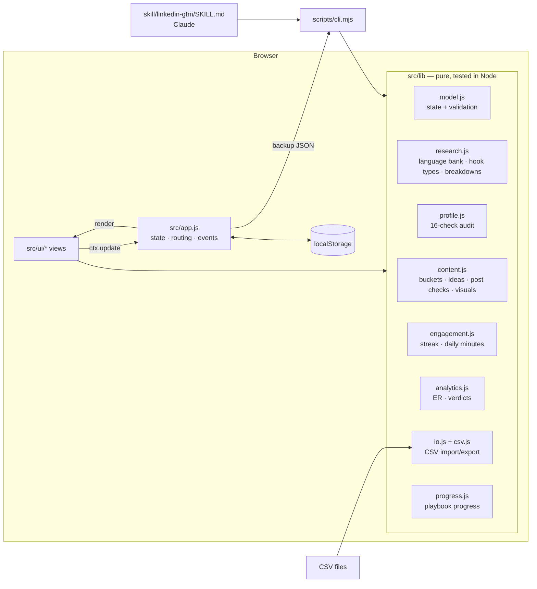

# Architecture

- **State:** `{ version, meta, activeId, workspaces[], log[] }`. A workspace holds `offer`, `buyers`, `competitors`,
  `compPosts`, `outsideIdeas`, `profile`, `posts` (with `metrics`), `engagement` and `settings`.
- **Rendering:** each view is a function `(ctx) → HTML string`; events are delegated in `app.js` through
  `data-action`, `data-form`, `data-change` and `data-live` attributes. Live checks (profile audit, post checks)
  update one container without re-rendering the form, so focus is never lost.
- **One rule set, two front ends:** the browser and `scripts/cli.mjs` import the same `src/lib` modules, so the
  Claude skill is checked by exactly the rules the user sees.
- **No network:** the only request is the sample JSON from the same origin.
